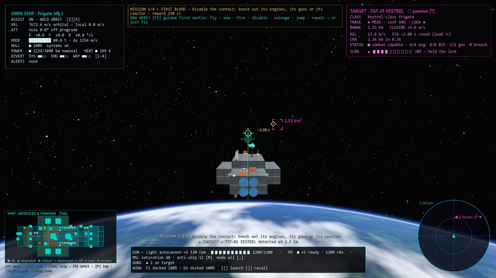
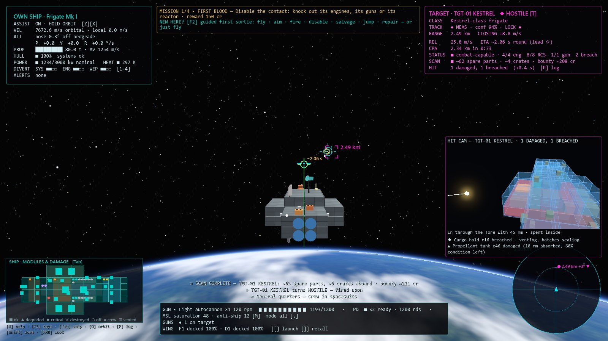
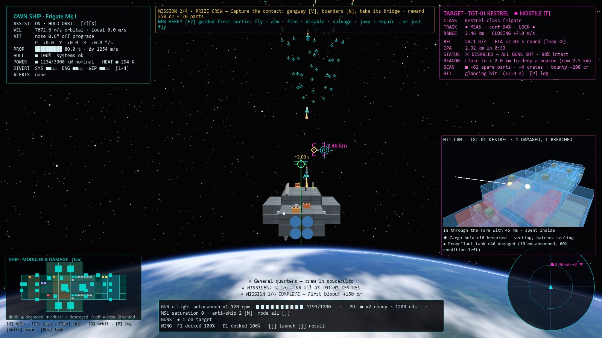
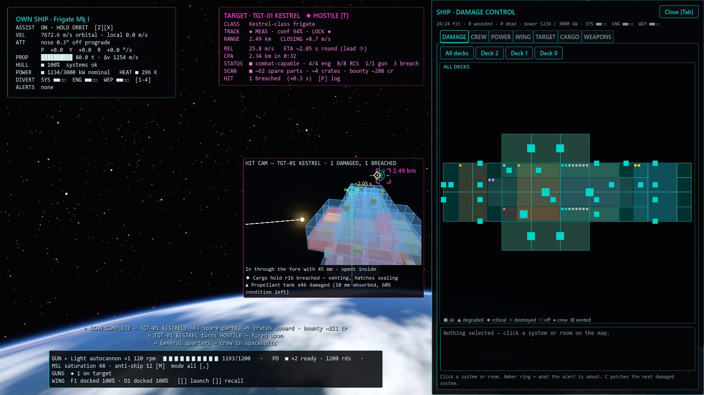
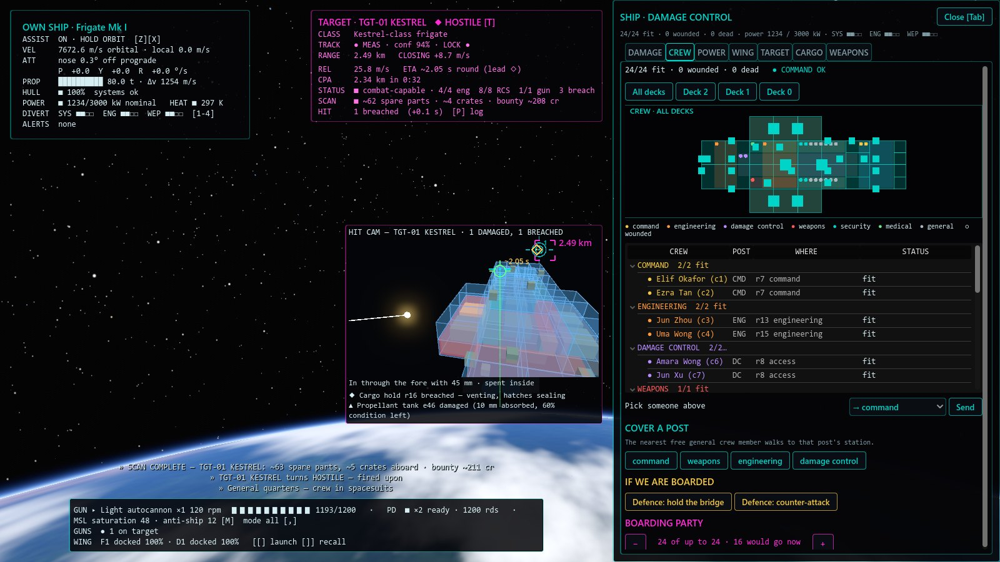
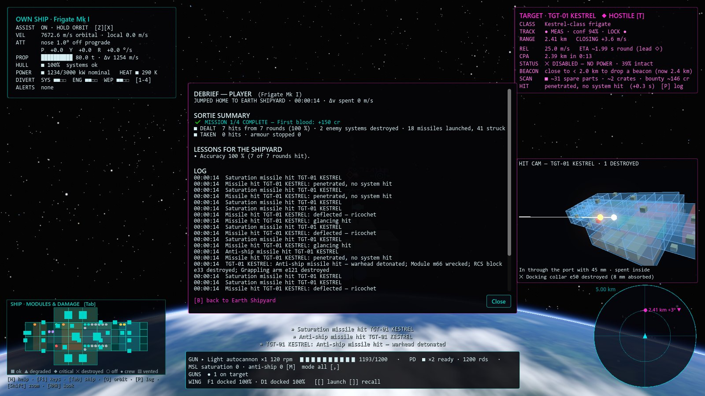
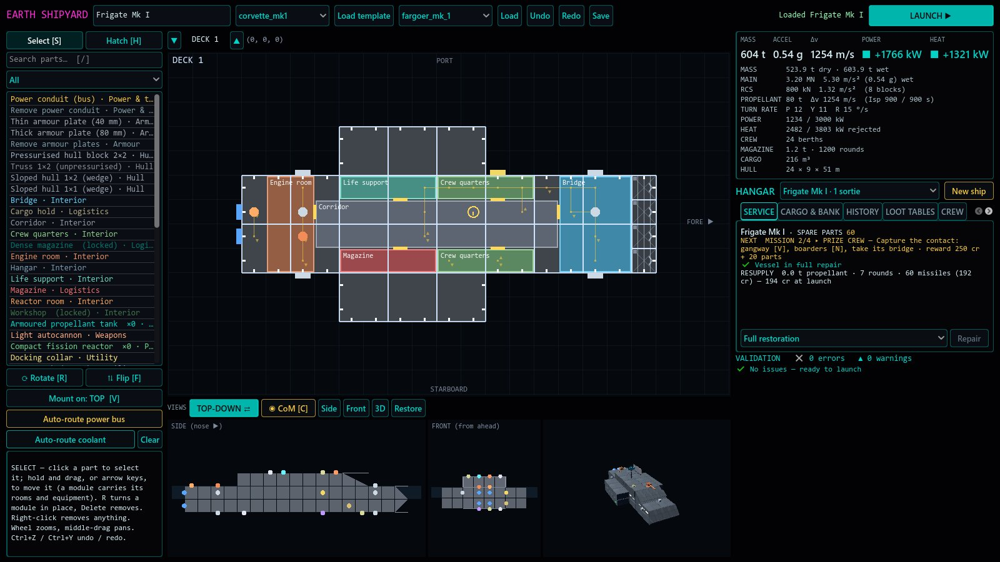
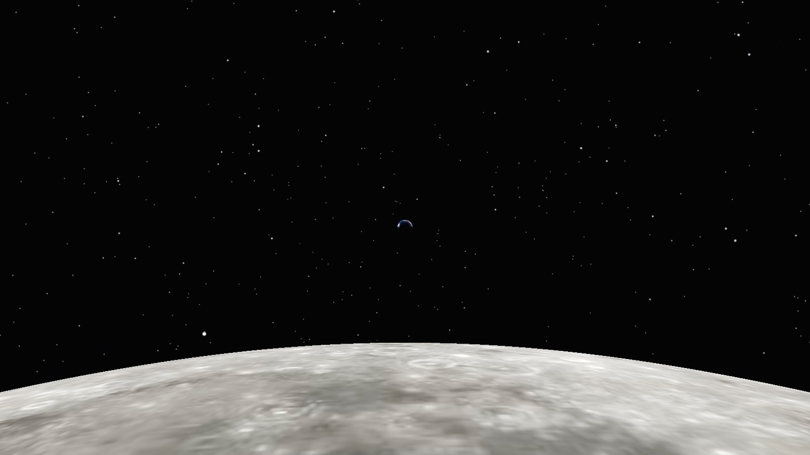
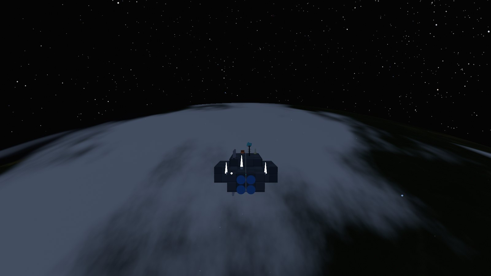
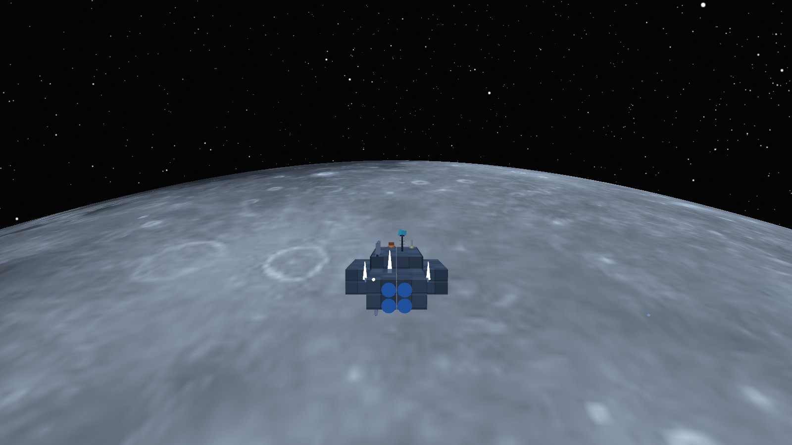

# NO SAFE ORBIT

*Keep the Delta-V Positive, or Else.*

A hard-sci-fi spacecraft engineering and combat simulator, built in Godot 4.
Your ship's construction determines how it flies, how it fights, how it fails,
and whether it survives.

**Status:** Milestones 0–10 complete — design a ship in the shipyard, then fly
and fight it in a real-scale 400 km Earth orbit or 100 km lunar orbit (pick
the station and the encounter's size, 1–3 ships, on the shipyard map) under
the real sky. Rounds
penetrate armour and wreck the systems in their path, and keep flying on their
own orbits afterwards; power, heat, pressure and propellant are simulated.
Guided missiles (anti-ship, saturation swarms, EMP, nuclear) fly salvos that
point defence can shoot down. Disable an enemy, salvage it for spare parts and
loot crates, dock, repair, refit and fly again — your vessel keeps its damage
between sorties, and a short mission chain (with an opt-in guided first
sortie) gives each fight a goal. A crew works the ship; dock a gangway and
board the enemy room by room; launch a fighter and a recon drone and give
them orders. Ships are built from blocks and sloped wedges, armoured with
plates you paint on, powered through a bus you route; turrets train on your
mouse aim. See [`docs/ROADMAP.md`](docs/ROADMAP.md).

## Screenshots

| | |
|---|---|
|  |  |
| **Flight** — own-ship and target cards, the mission goal and tutorial offer, lead marker, radar and damage map. | **Gunnery** — fire on the ◇ lead; the hit cam replays where the round went and what it broke. |
|  |  |
| **Missile salvo** — each press of M fires one launch from every pod the mode allows; a saturation pod's launch is eight missiles. | **Damage control** (Tab) — every system and room by deck, with crew dots; click one for its actions. |
|  |  |
| **Crew** (Tab › CREW) — a dot per person in their post's colour, the roster by post, orders and the boarding party. | **Debrief** — the mission result, what you dealt and took, and lessons for the shipyard. |
|  | |
| **Shipyard** — build from blocks and wedges, route power, paint armour; stats, repairs and the next mission alongside. | |

*Rendered with `godot --path . -s res://tools/capture_readme.gd` (a scratch
profile, never your save).*

## The sky is real

Nothing in the sky is decoration. Each item below is computed for the
scenario's moment, **2026-10-19 12:00 UTC**, from published astronomical
data, and the tests check it against known values.

| | |
|---|---|
|  |  |
| **The Moon from Earth orbit** at the deepest zoom (3°): waxing gibbous, 100° from the Sun as on that date, 401,000 km away and 0.50° across. Its night side glows faintly with **earthshine** (the "ashen light"). | **Earthrise from lunar orbit** at a normal field of view: Earth is 1.8° across, as it really is from the Moon. |
|  |  |
| **Earth from the Moon**, zoomed: real geography turned to that hour (Africa and Europe on the sunlit limb), clouds by latitude, and the phase that matches the Moon's. | **Midnight under the full Moon of 2026-10-26**: the Sun is behind Earth, so the clouds on the night side and the frigate's hull are lit only by moonlight. |
|  | |
| **Lunar midnight at the new Moon of 2026-10-10**: Earth is full as seen from the Moon, and its light (about 50 times a full Moon) lights the lunar night side. | |

### What is modelled

- **Stars:** all 9,096 stars of the Yale Bright Star Catalogue at their J2000
  positions. Each is sized by magnitude and coloured by its B−V index, so
  Rigel is blue-white and Betelgeuse orange. They are hidden behind the
  planet and the Moon, and dimmed where you see them through Earth's
  atmosphere.
- **The Sun:** its direction comes from the Astronomical Almanac's
  low-precision solar formula (accurate to ~0.01°). Earth's shadow is
  modelled, so ships go dark in eclipse, and the orbit panel predicts your
  next sunrise or sunset. The scenario starts 15° past local noon, about
  24 minutes before sunset.
- **Earth:** it turns at the sidereal rate from Greenwich sidereal time, so
  the right continents are under you. The map is NASA's Blue Marble for
  October, to match the season. On top of that: the atmosphere's limb up to
  the 100 km Kármán line, sun glint on the oceans, and clouds that drift.
  Seen from far off, the clouds follow Earth's real belts: cloudy at the
  equator (the ITCZ) and at 50–60°, clearer over the ~25° subtropical
  deserts.
- **The Moon:**
  - **Gravity and size:** its gravitational parameter is JPL's DE440 value
    and its mean radius 1,737.4 km.
  - **Orientation:** its north pole and prime meridian follow the IAU working
    group's model (Archinal et al. 2018), including the largest periodic
    term, the node's 18.6-year cycle. That tilts its pole 1.5° from the
    ecliptic pole, as Cassini's laws say it should be.
  - **Rotation:** it turns once per 27.32-day sidereal month, so the same
    face always looks at Earth.
  - **Surface and terrain:** the surface is NASA's LRO colour mosaic. With no
    air, the "entry interface" is the terrain itself: 11 km above the mean
    radius clears the highest summit.
- **Where the Moon is:** from the Astronomical Almanac's lunar series
  (~0.3°). From the Moon, Earth sits exactly opposite. Both show the phase
  that the real Sun–Earth–Moon geometry gives at that moment.
- **Moonlight and earthlight:** each body reflects sunlight onto the other
  and onto your ship, according to:
  - **Reflectivity and size:** its geometric albedo (Moon 0.12, Earth 0.434),
    times (radius ÷ distance)².
  - **Phase:** a phase law. For the Moon this is its measured curve, which
    includes the opposition surge that makes a full Moon more than twice as
    bright as the halves either side of it. For Earth it is a diffuse sphere.
  - **Results:** a full Moon gives 2.45 × 10⁻⁶ of sunlight, about 0.31 lux
    (measured: ~0.3 lux). A half Moon gives ~1/9 of a full one. Full Earth
    seen from the Moon is ~49 times brighter than a full Moon.

  The light falls on Earth's night side (or the Moon's), on ships, and on the
  other body's dark side (earthshine). Ships only get it while the light
  source is above the horizon.
- **The frame:** simulation axes are tied to ICRS/J2000 through the central
  body's pole. The start orbit is therefore a real prograde equatorial
  orbit about Earth or the Moon.

### Where it departs from reality (on purpose)

- **Night brightness:** real moonlight is ~400,000 times dimmer than
  sunlight, which would be invisible on a screen exposed for the Sun. Your
  eyes adapt across that range by about 20 stops; the game stands in for that
  adaptation. It shows a full Moon's light at 5 % of the Sun's, and scales
  other levels by Stevens' brightness law (perceived ∝ luminance^0.5).
  Night light is tinted blue, the way dark-adapted eyes see it (the
  Purkinje shift). The physical figures above are exact; only this display
  mapping is chosen.
- **Simplifications** (each under 0.5°): precession, nutation, aberration and
  light time are ignored. The Moon's position is the low-precision series,
  and only one far body is drawn per sky. Stars are at their J2000
  positions, with no proper motion.

### How it is checked (`tests/unit/test_celestial.gd`, `test_locations.gd`)

| Check | Reference | Result |
|---|---|---|
| Sun position, 1992-10-13 | Meeus example 25.a: RA 198.381°, Dec −7.785° | within 0.05° |
| Sidereal time, 1987-04-10 | Meeus example 12.a: 13h 10m 46.37s | within 0.001° |
| Moon position, 1992-04-12 | Meeus example 47.a: λ 133.16°, β −3.23°, 368,410 km | 133.26°, −3.31°, 368,077 km |
| Total solar eclipse, 2024-04-08 18:18 UTC | the Moon in front of the Sun | 0.43° apart |
| Full Moon, 2024-04-23 23:49 UTC | the Moon opposite the Sun | 178.4° |
| Lunar pole | ~1.54° from the ecliptic pole (Cassini state) | 1.51° |
| Lunar orbit at 100 km | 1.633 km/s, ~118 min | 1633.5 m/s, 117.8 min |
| Full-Moon light | ~0.3 lux against ~127,000 lux of sunlight | 0.31 lux |
| Half Moon vs full | ~1/9 (opposition surge) | 0.091 |
| Full Earth from the Moon vs full Moon from Earth | ~40–60 × | 49 × |

*Sky screenshots: `godot --path . -s res://tools/capture_sky.gd` (a scratch
profile, HUD hidden). Data sources and licences: `data/ATTRIBUTION.md`.*

## Requirements

- Godot **4.7.2-stable** (standard build, GDScript only — no .NET needed).

## Run

Open the folder in Godot 4.7.2 and press F5, or from a terminal:

```bash
godot --path .
```

The interface is laid out for 1600 × 900 and scales with the window (down
to the Steam Deck's 1280 × 800, up to 4K). F11 switches fullscreen and is
remembered in `user://settings.cfg`.

## Releases (Steam)

Published by **TheBooleanJulian**. Windows and Linux export presets carry
the publisher and the version (`0.12.0`); `tools/steam_export.sh` builds
both Steam depots with `THIRD_PARTY_NOTICES.txt` (credits and the Godot
licences, also in game under F1 → Credits & licences). The Steamworks
steps, store-page text and art sizes are in [`docs/STEAM.md`](docs/STEAM.md).

## Controls (rebind in game with F1; saved per user)

| Action | Keyboard / mouse | Gamepad |
|---|---|---|
| Pitch down / up | W / S (or ↑ / ↓) | right stick up / down |
| Yaw left / right | A / D (or ← / →) | right stick left / right |
| Roll left / right | Q / E | LB / RB |
| Main engine / reverse thrusters | R / F | left stick up / down |
| Strafe left / right | J / L | left stick left / right |
| Strafe up / down | I / K | RT / LT |
| Aim the turrets (aim cursor) | mouse — click to capture, Esc to release | screen centre |
| Orbit the camera around the ship / put it back behind | hold right mouse and move / right click | — |
| Toggle flight assist | Z | Y |
| Velocity hold: orbit → match target → target markers | X | X |
| Fire (each gun fires once it is on the aim) | Left mouse (once captured) or Enter | A |
| Zoom for gunnery (toggle; centres on the aim, the mouse turns the view; wheel = magnification) | Shift | right stick click |
| Next target: each ship of the encounter, then each hostile craft (lead marker only) | U | — |
| Grappling arm: grab / release | Y | — |
| Missile volley at the U target (the ship needs a sensor lock): one launch from each pod the mode allows | M | — |
| Missile mode: all / conventional / EMP / nuclear / sequence | , | — |
| Countermeasures: flares from every ready launcher | Space | — |
| Acknowledge the top non-critical alert | . | — |
| Orbit details / details & combat log / help panels | O / P / H | — (use Tab) |
| Target hostile on/off | T | B |
| Drop a salvage beacon on a disabled target / close the loot window | G | D-pad up |
| Damage control (workshop field repair) | C | D-pad down |
| Extend / release a boarding gangway | V | D-pad left |
| Send the boarding party / order it home | N | D-pad right |
| Divert power to systems / engines / weapons | 1 / 2 / 3 | paddles 1–3 |
| Balance power | 4 | paddle 4 |
| Tactical overview (ship map, power, crew, damage control, air wing) | Tab | left stick click |
| Launch craft / recall craft | [ / ] | paddle / Misc |
| Restart scenario (docks first: damage carries over) | Backspace | Back |
| Dimensional jump drive to the location's station (hold 5 s, not while under fire) | hold B | hold Start |
| Controls panel (rebinding), credits and licences | F1 | Guide |
| Fullscreen / window (remembered) | F11 | — |
| Guided first sortie: start / skip | F2 | — |

**Propellant:** the Frigate Mk I carries 80 t — about 1.6 km/s of main-engine
Δv; the RCS shares the main engines' propellant feed and exhaust velocity
(Isp 900 s), so manoeuvring costs no more per m/s than the mains. Flight assist's target-matching and
every manoeuvre spend it. Empty tanks mean no thrust and no RCS.

**Combat:** T makes the target shoot back — and a contact you (or your craft)
hit turns hostile on its own. Rounds penetrate armour (thicker at angles),
then breach rooms, destroy hatches, cut power conduits and damage whatever
systems lie on their path. Lost reactors, wrecked modules, cut conduits and
overheating (throttle at 380 K, scram at 450 K) take systems offline. The
target panel and the HIT TAKEN lines explain every hit.

**Guns** are balanced to similar damage rates; what decides a fight is the
armour you face (the hull skin is 20 mm; plates add 40 or 80 mm):

| Gun | Rarity | Penetration | Rate | Against |
|---|---|---|---|---|
| Light autocannon | common | 45 mm | 120 rpm | bare hull; stopped by light armour |
| Heavy kinetic cannon | uncommon | 90 mm | 60 rpm | light armour; stopped by heavy |
| Railgun | rare | 220 mm | 24 rpm | everything, unless it glances off at a steep angle |

Penetration doesn't fall off with range (vacuum); a head-on closing speed
adds up to 30 %. **Magazines hold mass** (300 kg a cell, 540 kg dense),
shared between the gun types aboard by mount count: heavier rounds, fewer of
them.

**Turrets:** guns train on the point under your aim cursor (at the target's
range) at their own traverse rate — 30°/s for the kinetic cannon, 60°/s for
the autocannon, 12°/s for the railgun — and each fires only once it is on
the aim. Guns of different kinds can share a ship: with a lock, each corrects
its own lead (put the cursor on the primary gun's ◇). Every gun has its own small reticle: cyan when on target, dim while
training, grey with a slash when it holds fire (its own hull in the line of
fire, the aim below its face, offline, or locked). Put the cursor on the gold
◇ lead marker. The ship AI (bridge crew lost) still lays the guns, at half
the rate of fire and with extra spread. With a gangway attached, both
ships' primary weapons are locked; craft still fight.

**Point defence:** PD turrets engage hostile missiles, craft and big slow
rounds on their own (their own rounds, gangway or not), never your side's.
Your **ship policy** (Tab › POLICY) sets the order (default missiles ›
craft › rounds), the engagement range (2 km) and an ammunition reserve
(below 15 % of its magazine a mount keeps the rest for its first priority).
Flak can only track heavy slugs (≥ 2 kg, closing under 1.5 km/s — the heavy
cannon's rounds); autocannon rounds are too small and railgun slugs too fast.

**Encounters:** from mission 4 two ships come at once, from mission 7
three, each with its own role — a *closer* works in to gun range, a
*standoff* ship holds 5–9 km off and fires missile salvos, a *flanker*
works round to your stern — and they focus fire (an escorted courier first)
and never waste fire on a wreck. The target card shows the selected
contact in full and lists the others compactly (**U** selects the next);
the radar, the world markers and Tab › TARGET show them all. Fire on one
and the whole encounter turns hostile. Salvage, the gangway, boarding and
missiles work on the selected contact; the next encounter arrives once the
last ship is beaten.

**Ship policy** (Tab › POLICY, saved with the vessel): automation layered
on your controls — **manual input always wins**: your trigger and M fire
whatever the policy says; automation only adds. Presets **Hold**,
**Defensive** (the default: point defence only), **Standard** (auto-fire
and auto-salvo, fire tight) and **Aggressive** (fire free, salvo everything
from 1 km), every value editable:

| Setting | What it does |
|---|---|
| Fire discipline | *hold*: automation never fires · *tight*: only at hostile contacts · *free*: at anything it has a solution on |
| Auto point defence | on/off, priority order, engagement range, ammunition reserve |
| Auto-salvo | at the selected contact when the lock quality, the range band and the interval allow: warhead mode and missiles per salvo |
| Auto-fire | pulls the trigger while your aim is within the tolerance of the lead and you hold a lock |

**Missiles (M):** launchers (Weapons palette; external, any face but aft)
fire guided missiles at the target picked with U — the enemy ship needs a
sensor lock, a craft must be in sensor range. **Each press of M fires a
volley**: one launch from every pod the **missile mode** allows. A rack or
an EMP launcher fires one missile and a saturation pod its swarm of eight.
Press again for the next volley; a tube cycles in 0.4 s. **,** cycles the
mode: *all*, *conventional* (anti-ship and saturation), *EMP*, *nuclear*,
or *sequence*. In sequence mode each press fires the next warhead in the
order set in Tab › WEAPONS, skipping any you have run out of. Put EMP
first, say, to blind their point defence before the anti-ship missiles
arrive. The mode and order are saved.
A missile flies proportional navigation within its acceleration and turn
rate, so it follows a jinking target; it arms after 1.5 s, has a proximity
fuse and self-destructs after 150 s. Rounds and point defence shoot
missiles down (each breaks up in a small fireball you hear) — that, and
staying out of reach, is the counterplay. The weapon strip shows
`MSL saturation 48 · anti-ship 12 [M]  mode all [,]`; our missiles are
small unlabelled markers, inbound ones are labelled and raise **MISSILE
INBOUND x.x s**. The yard restocks spent missiles at launch, cheaply.

| Launcher | Rarity | Missiles | Warhead | Restock |
|---|---|---|---|---|
| Missile rack | uncommon | 12 | anti-ship: 160 mm penetrator along its flight, then an 8 m blast inside | 2 cr |
| Saturation missile pod | rare | 48, **8 a launch** | small anti-ship: 45 mm penetrator, 3 m blast — weak alone, a swarm saturates point defence | 1 cr |
| EMP missile launcher | rare | 6 | EMP: resets unhardened electronics, no damage | 5 cr |
| Nuclear missile launcher | legendary | 3 | radiation, heat and EMP; no blast wave in vacuum | 30 cr |

**Countermeasures (Milestone 11):**
- **Flares.** A flare launcher (common, Weapons palette) carries 30 flares
  and fires three per launch: Space, or automatically under a policy that
  allows it (Defensive, Standard and Aggressive do: when a missile is 4 s
  out). Each flare is a bright heat source that burns for 6 s.
- **How a missile sees a flare.** A missile that sees one inside its seeker
  cone, near its target, may chase it instead. The odds are the flare's
  signature against the ship's, weighted by the seeker:
  - **Signatures:** a flare starts at 2.5. A frigate at rest is ≈1, and
    engines at full burn make it ×2.5.
  - **Seekers:** saturation missiles are fooled most easily; nuclear
    missiles have the sharpest seekers.
  - A seduced missile bursts harmlessly on the flare.
- **Timing matters.** Fire as the missile closes, 3–5 s out. Flares fired
  early burn out, and a missile with you still in its cone simply finds
  you again.
- **Jamming.** An EW jammer (rare, 150 kW) cuts enemy sensor-track
  confidence, breaks their locks and makes their missiles lose lock now
  and then:
  - **Burn-through:** it does nothing inside 3 km and is at full strength
    beyond 6 km.
  - **Counterplay:** a hardened sensor mast filters most of it.
  - **EW drone:** the drone (rare, its own drone rack) holds station
    1.2 km out towards the threat and spreads the jamming to ships of its
    side within 3 km.
  - **In game:** the target card shows **JAMMED −n %** when your track of
    it is degraded, and the WEAPONS tab and the help card (F1) explain it.
- **Enemies.** They carry flares from mission 3 and sometimes a jammer
  from mission 6. The yard restocks flares at 1 cr each.

**EMP and hardening:** an EMP resets electronics — reactors, guns, point
defence, sensors, power distribution, collars, racks, arms and launchers —
for up to 20 s at full strength (90 s at most, falling with the square of
the distance); internal systems see half, engines, tanks and radiators
nothing. Each comes back on its own (the **EMP RESET** caution lists them).
Hardened parts shrug off most of it: the **hardened sensor mast** and
**hardened power distribution unit** (uncommon, heavier) by 85 %, reactors
by 50 %.

**Nuclear:** the crew's dose is the exposure divided by the armour facing
the burst (1 + mm / 60): sickness from 0.4, deaths from 1.5. The hull heats
up (up to +400 K), close in the facing hull is ablated, and an EMP comes on
top. It imparts no momentum.

From mission 4 enemies carry a missile rack and fire when they hold a lock
inside 12 km, every ~25 s; from mission 6 some carry an EMP launcher too.

**Sound:** what you hear is your own ship through the hull, because there
is no sound in vacuum:
- guns, missiles leaving the tubes, the clang of hits and ricochets;
- the engines' rumble (every main engine, reverse and side ones too,
  louder and a touch higher as the throttle opens) and the RCS jets' hiss;
- the machinery's hum and the jump drive spooling;
- warheads and reactors going up (an enemy's is a faint thud);
- an alarm for each alert class.

These are recorded CC0 samples (Kenney's Sci-Fi, Impact and Interface packs;
see `data/ATTRIBUTION.md`); any slot without one is synthesised. Alarms play
on their own bus and duck everything else, so they are always heard.

**Scans:** hold a lock (inside 10 km) with a working sensor mast for 4 s to
read a contact's cargo — spare parts and crates aboard — its scrap value and
the bounty on it, ±15 %.

**Collisions:** ships that touch push apart and are damaged by the impact.
Ramming is a real weapon and hurts both ships: the blow is shared by
toughness (mass × local armour, to the power 1.5), so the lighter, thinner
side takes far more, and it spreads into the modules within three cells and
the external systems near the impact. An 8 m/s Cutter-into-Destroyer ram
costs the Cutter about a third of its structure and the Destroyer under
1 %. Ships joined by a gangway, and craft near their own carrier, don't
collide.

**Rounds never expire.** Misses coast on their own orbits — around the planet
and, half an orbit later, possibly back through you. Far from the fight they
are propagated exactly (two-body Kepler) and come back into the simulation
when their orbit returns; the HUD counts rounds near and in far orbit and
warns of any round on a collision course. Firing pushes your ship back
(recoil, including the spin from off-centre mounts), and every hit shoves and
spins the ship it strikes. A round that punches through keeps going, slower.

**Hit cam:** each hit you score opens a small X-ray replay of the target —
the round's path through the hull and every module it damaged or destroyed,
in order (the most severe recent hit wins the window).

**Sky:** stars, Sun and the central body's rotation are real for 2026-10-19
12:00 UTC (Yale Bright Star Catalogue, NASA Blue Marble, NASA CGI Moon Kit;
see `data/ATTRIBUTION.md`). The Moon hangs in Earth's sky and Earth in the
Moon's, where they really are that day, in phase, and their reflected light
lights the night side and your hull in shadow. Zoom with Shift and the wheel
to see them. See [The sky is real](#the-sky-is-real).

**Flight assist ON** (default) damps rotation to the requested turn rate. X
cycles three modes:

- **HOLD ORBIT** (default): uncommanded axes coast. You stay on whatever orbit
  your burns put you on, and coasting spends no Δv.
- **MATCH TARGET**: uncommanded axes thrust to null your velocity relative
  to the target, within real thrust limits. That costs Δv.
- **TARGET MARKERS**: coast as in HOLD ORBIT, but the prograde / retrograde
  markers show your motion relative to the target (yellow) — put the yellow
  ring on the target to head for it, without matching velocity.

The target card's **CPA** line gives the closest approach on present
courses: how near and in how long (and COLLISION COURSE inside 50 m).

**Manual** (Z): no hidden damping at all; spins persist until you counter-thrust.

**Orbit:** you start in a 400 km circular Earth orbit at 7.67 km/s (period
≈92 min). Burn prograde (along the green ring) to raise the far side of your
orbit, retrograde to lower it. The **entry interface is 100 km** (the Kármán
line). If your periapsis drops below it, the HUD warns you and counts down.
Crossing it ends the flight; Backspace restarts.

**Lunar orbit** (Lunar Shipyard): 100 km circular at 1.63 km/s (period
≈118 min). The Moon has no air: the floor is the highest terrain, 11 km up
(TERRAIN on the orbit panel); dipping below it is a crash.

HUD markers: white reticle = where the nose points; green ring = orbital
prograde (where you're actually going), green ⊗ = retrograde; thin green line =
projected orbit with Ap/Pe markers; orange bracket = target (arrow at the
screen edge when off-screen); gold ◇ = lead (put the reticle on it and fire).
Bottom right: flat radar (stalk = height above/below your plane; ▼ closing,
▲ opening).

## Campaign: salvage, loot, repairs

**Missions.** The current goal sits at the top of the screen (gold) and
in the hangar, and opens the debrief: ✔ met, ✕ failed, ▲ not met yet. A
goal not met carries over to the next sortie.

| # | Mission | Goal | Reward |
|---|---|---|---|
| 1 | First blood | Disable the contact | 150 cr |
| 2 | Prize crew | Capture it: gangway, boarders, take its bridge | 250 cr + 20 parts |
| 3 | Courier run | Escort the courier (it is the contact's target) until the contact is disabled | 300 cr + 10 parts |
| 4 | Hold the line | Beat 2 contacts in one sortie | 400 cr + 30 parts |
| — | Patrol | Disable or capture each contact | 100 cr each |

**Tutorial.** A new pilot is offered a guided first sortie: press **F2**
and one prompt at a time (teal, under the goal) walks you through flying,
aiming, firing, disabling, salvaging, jumping home and repairing — each
moves on when you have done it. F2 again skips it; F2 later restarts it.

1. **Disable** the target — knock out its guns, its power or its bridge. A
   clean disabling shot pays better than shooting it to pieces.
2. **Cash it in**, one of two ways:
   - **Salvage beacon** (**G**, within 2 km): Earth Shipyard's tug brings
     the wreck in. You get **50 %** of its scrap value (what its intact parts
     are worth at the yard) and the bounty (`100 + 100 × intact`) in credits
     now; its 1–5 crates each hold loot **60 %** of the time and go into your
     **cargo hold**.
   - **Boarding takeover** (see Crew and boarding): **80 %** of the scrap
     value and double bounty; its stores (`10 + 50 × intact` spare parts) and
     crates (+2, **90 %** loot each) go into your **cargo hold**.
   Loot in the hold is at risk until you bank it, and limited by its size.
   Either way the wreck's best intact rare part comes too, the crates open
   on a spinning carousel, and the next contact arrives — each one tougher
   (rarer guns, armour plates, RCS and reactors). The beaten ship doesn't
   vanish: it stays as a grey-marked **WRECK**, drifting clear of you, its
   guns, point defence and craft silent (the four most recent are kept).
3. **Loot** uses cascading weighted rarity: every crate starts Common and
   climbs a tier with 30 % / 30 % / 25 % / 20 % chances (Common 70 %,
   Uncommon 21 %, Rare 6.75 %, Epic 1.8 %, Legendary 0.45 %), then picks a part
   of that tier by weight. A tier with nothing in it falls back to the one
   below. Hard pity: at least Rare every 10 crates, Legendary every 80. Common
   crates hold spare parts; rarer ones hold equipment units (railgun, torch
   drive, high-Isp engines, Mk II reactor, heat-pipe radiators, armoured
   tanks, …) or blueprints for hull modules and rooms (armoured sections,
   monocoque fuselage, workshop, dense magazine). Duplicate blueprints are
   scrapped for spare parts. The rates and pity countdown are shown with every
   salvage.
   The **cargo hold** holds 27 m³ per free cargo-hold cell (tanks take
   space): a spare part is 0.25 m³, a crated system 1 m³ per 2 t. Over
   capacity, an amber alert asks you to vent — Tab → CARGO lists the hold
   with a Vent button per line and "vent excess" (cheapest first); the jump
   vents the excess itself.
4. **Jump home**: hold **B** for 5 s — the **dimensional jump drive** to
   Earth Shipyard. It won't charge while a hostile has fired on you in the
   last 10 s (one that hasn't opened fire doesn't stop it). Craft still out
   and boarders still across are **left behind** — an emergency jump, with
   a red countdown naming them; release B to wait for them. The vessel
   keeps exactly the damage it came back with (also when you restart, or
   quit mid-sortie). The
   station opens on the **debrief**: what you hit, where the hits on you came
   from, what armour stopped, what you lost, and lessons for the shipyard
   (saved under `user://debriefs/`) — it opens with a **sortie summary**:
   the mission result, what you dealt, what was done to you and from which
   side, which systems you lost and the crew it cost. **Bank cargo** to make the hold's
   contents safe. Spend credits at the station (see below).
5. **Death** loses only what is in the cargo hold. The station rehires,
   rebuilds and rearms the same design — rare parts fitted to it included —
   for a respawn fee in credits (50 + 5 per berth). Backspace respawns in
   orbit; B returns to the station. The debrief shows either way.
   **Stores carry over:** the propellant and rounds you come back with are
   what you leave with, unless the yard tops them up at launch — 1 credit a
   tonne of propellant, 1 credit per 10 rounds (propellant first when credits
   are short; HANGAR → SERVICE shows the bill). Craft refuel and rearm from
   the carrier's own tanks and magazine.
6. **Repair** at the shipyard's HANGAR & SERVICE panel, paid in spare parts
   (a part's repair costs its new price × how damaged it is). Short of parts?
   Choose what comes first: full restoration, combat readiness, mobility or
   hull integrity. Unrepaired parts fly as they are.
7. **Refit / relaunch**: new parts in an edited design must be paid for at
   launch. Rarer parts can only be used if you own enough units / have the
   blueprint — the validator says what is missing.

**Earth Shipyard's station** (HANGAR tabs):

- **CREW**: your vessel's named crew — change roles for free, dismiss; hire
  from a pool that changes every sortie (★ skill: each star works 20 %
  faster at repairs and treatment; 40 cr + 40 a star). The dead leave their
  berths, which you fill by hiring.
- **QUARTERMASTER**: Okafor sells three rarer parts for credits (new stock
  every sortie) and spare parts.
- **UPGRADES**: ship technology for every vessel (thrust +5 %, radiators
  +8 %, reactor output +8 % a level) and the captain's training (rate of
  fire +5 %, damage control +15 %, medicine +15 %, salvage credits +5 %),
  three levels each at 300 / 700 / 1500 cr.

In flight, a ship with a **workshop** (a found room blueprint) that is
powered, pressurised and reachable can patch damaged systems to 75 % (**C**):
a damage-control (or engineering) crew member walks there first, it costs
spare parts, and it stops if the workshop or the part's room loses pressure
or the repairer is hurt. Destroyed parts still need the yard. When the crew
  can patch something, an amber line in the middle of the screen says
  "press [C]".

## The HUD

Kept compact so the fight stays in view:

- **Own ship** (top left): assist mode, inertial (orbital) velocity, where
  the nose points relative to the velocity vector, turn rates, propellant,
  hull, power / heat, power pips, and a **STATUS** line that never moves:
  `RCT ■  BRCH ■  FIRE ■  VENT ■` (reactor, breaches, fires, vented rooms).
- **Target** (top right): identity and the **sensor track** — `MEAS`
  (measured now), `EST` (dead-reckoned) or `STALE` (old), its confidence and
  whether you have a **lock** (needed for the ◇ lead marker; inside 10 km).
  Estimates are prefixed `~` and drawn as a dashed ring with a `?`. Then
  range, closing speed, relative speed, round ETA, status (needs a close
  look), and salvage / docking / boarding lines when they apply.
- **Weapon strip** (bottom): gun and ammunition, point defence (none
  fitted yet), the air wing. Above it, a ticker of recent events.
- **Attention line** (centre of the screen): the worst danger in big
  pulsing red (the same short line as its alert), or, with none, an amber
  `PATCH … [C]` when the crew can patch damage.
- **Craft markers**: small diamonds (magenta theirs, cyan ours) with range;
  U puts the lead marker on a hostile craft.
- **On demand:** O orbit details, P details & combat log (local velocity
  axes, Δv spent, rounds up, last hit reports), H the full controls card.
- **Alerts** (the banner, top centre): at most three, most urgent first.
  Each is a few words, e.g. `◆ MSL 2.4km 002`, `◆ RND 0.4s 330 [R]`,
  `▲ FIRE r12 [Tab]` or `▲ SCRAM 1450K [Tab]`:
  - a shape (◆ danger, ▲ caution, ● advisory) and a short noun;
  - one value;
  - for threats, the bearing from the nose (clockwise, ↑/↓ when steeply
    above or below);
  - the key that acts on it. For a round, that's the strafe key that
    crosses its path fastest.

  How the queue behaves:
  - They don't flicker: an alert stays up 0.8 s after its condition
    clears. It escalates at once and only steps down after a steady second.
  - Each class has its own alarm: threat, damage, systems, navigation,
    information.
  - Incoming missiles and rounds get a red chevron on the threat, or at the
    screen edge pointing to it.
  - The damage map flashes the system the top alert is about.
  - **.** acknowledges the top non-critical alert; it stays hidden until it
    clears or escalates. Tab opens damage control on the system it is about.
- In **match-velocity** mode the prograde/retrograde markers turn yellow and
  show motion relative to the target (green = orbital).
- States are shapes as well as colours: ■ functional · ▲ degraded ·
  ◆ critical · ✕ destroyed · ○ off / unpowered · ● crew. Cyan is you and
  your systems, magenta hostiles, amber caution, red danger.

**Sensors:** the sensor mast sees 25 km; without it, 3 km. A new contact
after a salvage arrives about 30 km out and closes — it can't engage until
you have detected it.

**Hits:** steep hits stopped by the outer plate ricochet (white sparks with
long streaks); rounds that pierce leave black entry holes and wider, ragged
exit holes on the hull.

## Running the ship

- **Damage map** (bottom left, always on): modules by structure, rooms by
  pressure, systems by state, crew as dots.
- **Power** (1 / 2 / 3, 4 to balance): six pips across SYS (turning and
  repair speed), ENG (thrust) and WEP (rate of fire), 0–4 each: 50 % at 0
  pips, 100 % at 2, 150 % at 4.
- **Damage control** (Tab): a drawer on the right (the fight stays
  visible) with tabs — DAMAGE (deck-by-deck map; click a system or room for
  its details and actions: dispatch a repair crew, switch a load off to
  reroute power, divert power to its channel, isolate / reopen a
  compartment), CREW (a crew map with a dot per person in their post's
  colour — ring = wounded — and the roster by post: who, where, doing what;
  pick someone and send them to a new post, cover a post with general crew,
  defence policy, boarding party size and how many would go), POWER (pips
  and every load's switch), WING, TARGET (our boarders as post-coloured dots
  with a white ring among the defenders' red ones), CARGO, WEAPONS
  (launchers, missile mode and sequence order).
- **Bridge crew lost**: the ship AI flies it with half thrust and turn rate,
  assist locked on, and lays the guns at half rate with extra spread, until
  someone takes over the bridge.
- **Power bus**: systems and rooms are powered only on a conduit network with
  a reactor and a working power distribution unit; hits cut conduits (Tab
  shows what went dark). The yard re-runs cut conduits.
- **Reactors explode** at 0 %: blast damage within 15 m, falling off with
  distance.
- **Coolant loop** (optional, shipyard "Auto-route coolant"): once piped,
  only radiators on a loop that reaches a reactor reject heat, and hits can
  cut pipes (the yard re-runs them). Unpiped designs cool as before.
- **Hull breaches** are sealed by damage control one room at a time (30 s,
  faster with a bigger workshop) when a workshop and life support work;
  life support then refills the room with air.
- **Fire**: a hit system may catch fire. It burns only with air
  (smoulders in a vented room, flaring up if it is re-pressurised), damaging
  the room's systems and crew. Automatic **foam** puts it out in 3 s — two
  charges per room, recharged at the yard — then damage control fight it
  by hand.
- **Bigger rooms work harder**: each cell past the first adds 25 % (up to
  2×) — a bigger bridge scans faster, a bigger workshop repairs and seals
  faster, a bigger life support (the medbay) treats the wounded faster.
- **Grappling arm** (Y, within 60 m of the arm, under 5 m/s): takes out a
  ship's tumble, matches its velocity, and — with collars on both — turns
  it so its collar faces yours and reels it in for V. It siphons a
  disabled or captured hulk's propellant and rounds while it holds.

## Air wing: fighters and drones

The Frigate Mk I carries a **Wasp fighter** in an internal **fighter bay**
(its hangar door is on the underside) and a **recon drone** on an external
rack. They fly with the same physics as every ship and can be shot down.

- **[** launches (the bay or rack must work and the ship must be turning
  slowly); **]** recalls. A craft is recovered when it comes within 10 m of
  its door or rack at under 2 m/s, then rearmed and refuelled for 40 s.
- Orders, per craft, in the tactical overview (Tab): **Strike** (gun runs
  on the target, aimed at hull, guns, engines or reactor), **Intercept**
  (enemy craft first), **Recon** (hold 1.5 km off the target, never fire),
  **Escort** (fly beside you), **Return**. **Risk tolerance**
  (conservative / balanced / aggressive) decides when a craft breaks off on
  its own for damage, propellant or ammunition.
- Out of contact (beyond 30 km, or jammed) for 10 s, a craft falls back to
  returning home.
- **Recon** gives the close look that shows the target's systems: without a
  drone nearby you see them only within 3 km.
- **Craft types** (each rack's info in the shipyard and each craft's line
  on the WING tab say what it does):

  | Craft | Carried in | Role |
  |---|---|---|
  | Wasp fighter | fighter bay | gun runs on the target; screens the carrier |
  | Hornet interceptor | interceptor rack | shoots down missiles aimed at its carrier (within 4 km) first, then fights craft |
  | Mantis bomber | bomber bay | heavy 45 mm cannon from long range; keeps its distance |
  | Recon drone | drone rack | the close look at the target's systems; never fires |
  | EW drone | EW drone rack | holds 1.2 km out towards the threat and jams for ships within 3 km |

- **How they fly:** a craft never fires with a friend within 25 m of its
  line of fire, its rounds carry an IFF interlock that passes through your
  ships and craft, it keeps 70 m from other craft and 120 m clear of hulls, and
  a strike is a gun run (run in, break off at 600 m, come round). The WING
  tab's HOW THEY FLY block lists every directive and risk setting.
- Enemies launch their own fighter from mission 3 once hostile,
  interceptors from mission 5 and bombers from mission 7.
- A craft still out when you dock is lost. Lost craft are replaced, and
  damaged ones repaired, at the station.

## Crew and boarding

Every berth (3 per crew-quarters cell) holds one named crew member with a
role: command (bridge), engineering, damage control, weapons (magazine),
security, medical and general crew. They are not drawn; moving between
rooms takes 5 s per room. While a hostile is about the crew are at **general
quarters in spacesuits**: they cross vented rooms and survive a room venting
around them (otherwise venting wounds or kills whoever is in it). No command
crew on a pressurised bridge hands the ship to the ship AI (half thrust and
turn rate); no weapons crew able to reach the magazine halves the guns' rate
of fire. Tab → CREW: cover a lost role with general crew, or **reassign**
anyone free to a new post (they walk there). The dead leave their berths
(hire replacements at the station); the wounded recover when you dock.

**Boarding** a disabled ship:

1. Come alongside with matched velocity. The target panel shows the docking
   tolerances: port gap ≤ 25 m, relative speed ≤ 0.5 m/s, turn rate ≤ 3.4°/s,
   gangway within 20° of square.
2. **V** extends the gangway from your docking collar: mated to the target's
   collar in 10 s, or cut into any outer hull face with a room behind it in
   45 s (that room vents). A target that still has power, thrust and a crew
   in command thrusts away and tears the gangway — disable it first.
3. **N** sends your security and general crew — the party size is set in
   Tab › CREW, up to 24, and the target card says how many would go before
   you press it (enemy parties stay at 8). They walk to the
   collar, cross, and fight room by room towards the bridge. Defenders lock
   the doors ahead (20 s to cut each; hatches your guns already destroyed
   are open) and their security falls back to hold the bridge. Fights are
   resolved by numbers and roles, not instant kills: a full crew will
   usually repel eight boarders, so thin them out first — venting their
   quarters, or cutting straight into a bridge that sits under the hull.
The hit-cam window shows the boarded ship's rooms while the fight goes on:
cyan = taken, pulsing magenta = fought over, red = defended. Within 150 m a
**docking cam** shows the view out of your collar with the tolerances, and
every ship's docking collar is hazard-striped with a blinking beacon.

4. Take the bridge and the ship surrenders: the takeover pays out at once
   (80 % scrap, double bounty, its stores and crates into your hold) and
   your party withdraws on its own; once it is home a prize crew holds the
   ship (it stays as a drifting wreck) and the next contact comes. **N**
   orders a withdrawal at any time (an
   amber alert reminds you while a party is across); if the gangway is gone,
   they are stranded. The jump drive waits for them.

**Being boarded:** from mission 2, an enemy that has disabled you closes in,
lines up a collar and sends its own party. **V** cuts its gangway loose.
Tab → CREW sets your defence: hold the bridge (security fall back, doors
ahead locked) or counter-attack (security and general crew go to meet them).
Lose the bridge and the vessel is lost. A medic aboard treats one wounded
crew member every 25 s with a working life support room (faster when it is
bigger), twice as long without one. After you cut its gangway, an enemy
waits 20 s before trying again.

Progress is saved to `user://profile.json` (versioned JSON) — on Windows
`%APPDATA%\Godot\app_userdata\No Safe Orbit\profile.json`, with saved designs
in `blueprints\` beside it. Running the game (F5 or `godot --path .`) uses
that real save; the automated checks never do (they boot with
`-- --profile=user://check_boot_profile.json`). Copy the folder to back it up.
Each save is written to a temporary file and read back before it replaces
the profile; the save before it is kept as `profile.json.bak`. If the
profile is ever damaged, the game keeps it aside as
`profile.json.unreadable`, loads the backup and says so (top of the screen
and the shipyard status line) — it only starts a new profile when there is
no usable backup. Loading an older save version first keeps a copy
(`profile.json.v3`, …) before it is migrated.

## Shipyard

**Earth Shipyard** (or the **Lunar Shipyard**) opens after a jump (hold B in
flight). It is a station with sections along the top; the builder is one of
them:

| Section | What's there |
|---|---|
| **STATION** (opens here) | Your ship in 3D; cards for repairs, rearm, crew and the next sortie, each with a button to its section |
| **MISSIONS** | People at the yard with work. A navy liaison, a merchant guild factor, a bounty broker, a salvage boss and station security offer contracts: bounty, capture, escort, defend, salvage. Accepting one sets where your next sortie flies, how many ships it meets and how dangerous they are, and it pays when its goal is met. One at a time; new offers after every sortie |
| **DEALER** | Every template for credits, with its standard crew hired: Cutter, Corvette, Frigate, and capital ships (Destroyer, Cruiser, Carrier). The price is the parts at station rates plus the hull fee, with a 25 % margin, plus the crew at the hiring fee |
| **HANGAR** | A card per vessel (fly another), new hulls, scrap (half its parts back, never your last ship), the hold and the bank, the service record |
| **REFIT** | The builder below |
| **CREW** | The roster by post, who is for hire |
| **ARMOURY** | Rearm and refuel now (or leave it to the launch), the quartermaster's parts |
| **REPAIRS** | Damage and what fixing it costs |
| **UPGRADES** | Station technology |
| **MAP** | Where you launch from, how many you meet |
| **LOOT** | Every crate drop and its odds |

In REFIT you start from the ship you were flying (the Frigate Mk I template
by default).

**Map** (HANGAR › MAP, or the ◎ route button beside LAUNCH): click Earth or
the Moon to move the vessel to that station; the next launch starts in its
orbit. Pick the encounter: **1, 2 or 3 ships**. Moving is free for now
(jump fuel comes with Milestone 13).

**Hull** is built from four blocks: a 2×2×1 **pressurised block** (rooms go
inside), 1×2×1 and 1×1×1 **sloped wedges** and a 1×2×1 **truss**. Wedges
are angled armour: a level shot meets a 45° slope √2 × thicker, and the long
wedge's shallow slope deflects it. **F** (or ⇅ Flip) turns a wedge upside
down to slope down. Trusses are an open lattice (no rooms). Any common face
attaches two blocks. (The old large sections still load and fly but are no
longer offered.)

**Templates**: Cutter Mk I (light, ~150 t), Corvette Mk I (medium, ~365 t)
and Frigate Mk I (heavy) — common parts only, so any profile can fly them.

**Armour** (palette → Armour): drag across cells to fit 40 mm (thin, grey)
or 80 mm (thick, dark grey) plates on their exposed faces — all, sides only, top
only or underside only — or strip them; **Clear all armour** strips the
lot (Ctrl+Z puts it back). A plate on a face you later build over (a new
deck or module) goes with that edit, mass and all. Plates add mass
(1.44 t / 2.88 t a face), cost spare parts at refit, wear when hit and are
re-plated at the yard.

**Power** (palette → Power & thermal): drag **power conduit** through hull
cells (it joins between decks too). A system or room is powered when one of
its cells is on a network with a reactor and a **power distribution unit**.
**Auto-route power bus** lays a tree to everything. A design with no conduit
uses automatic distribution through its hull. **Auto-route coolant** pipes
the reactors to the radiators and heat-making systems (Clear removes it).

**Engines**: aft faces always; any other face if an **engine room** is on
the inside of that cell — it pushes the ship away from that face. Engines
trade thrust for Isp (thrust × Isp is the budget: standard 800 kN / 900 s,
high-Isp 620 kN / 1400 s, high-thrust 1.45 MN / 600 s; the torch drive
1.2 MN / 1800 s). **Radiators** are 3-cell folded panels (old 2-cell ones
still fly). Rooms of the same type side by side are one space — no hatch
needed between them.

| Action | How |
|---|---|
| Pick a part | Search box (/) and category: Hull, Armour, Interior, Propulsion, Power & thermal, Weapons, Sensors, Utility, Logistics |
| Read a part | Its card: mass, power and heat, durability, cost, and what it does (gun rate of fire and penetration, thrust and burn, output…) |
| Place | Click on the deck grid (rooms, armour, conduit: drag a rectangle). The ghost turns red and the hint bar names the problem before you click. |
| External equipment face | Near a cell edge: that side; the middle: the top or the underside, whichever is open — when both are, **Mount on: TOP / UNDERSIDE [V]** decides (Shift: the other) |
| Rotate a module | R or ⟳ Rotate (while placing, or with a module selected); R also turns a radiator across the ship |
| Main view | TOP-DOWN ⇄ ISOMETRIC: the isometric view (from the front-left) cuts away the decks above, shows rooms and systems, turns with ⟲ ⟳ and edits like the deck editor |
| Zoom / pan | Mouse wheel / middle-drag on the deck editor |
| Centre of mass | ◉ CoM [C]: a marker in the deck, side and front views and a sphere in 3D |
| New ship | HANGAR → New ship: design on an empty slip, COMMISSION builds it (every part + 250 cr) as another vessel; the picker switches vessels |
| Testing aid | HANGAR → CARGO & BANK → DEV +100 cr |
| Loot odds | HANGAR → LOOT TABLES: crate odds, tier odds, every item |
| Select / move / delete | Select tool (S): click and drag, or arrow keys, Delete; Shift-click modules to move several together, Ctrl+A for the whole hull (everything inside comes along) |
| Old designs | HANGAR → SERVICE → Convert to blocks: rebuilds old large sections from blocks with plates (free on your own vessel) |
| Remove anything | Right-click (a room takes its hatches with it) |
| Hatches | Hatch tool (H): click near an edge for a door, a cell's centre for a ladder to the deck above (Shift: below) |
| Change deck | ▲ / ▼ or PgUp / PgDn |
| Save / load | Top bar (saved to `user://blueprints/`); "Load template" restores the Frigate Mk I |
| Fly it | LAUNCH ▶ (disabled while the design has errors; warnings are allowed; new parts are paid for in spare parts) |
| Bigger views | VIEWS bar: Side, Front or 3D fill the main area; Restore |
| Repair the hangar vessel | HANGAR → SERVICE: pick a priority, then Repair |
| Bank cargo, buy parts | HANGAR → CARGO & BANK |
| Crew, quartermaster, upgrades | HANGAR → CREW / QUARTERMASTER / UPGRADES |
| Vessel history, last debrief | HANGAR → HISTORY |

Palette colours show rarity (grey Common, green Uncommon, teal Rare, violet
Epic, gold Legendary); rarer equipment shows how many units you own, rarer
hull modules and rooms show "(locked)" until you find their blueprint.

Errors (✖) are physically or structurally invalid designs: overlapping or
unattached modules, rooms outside the pressurised hull, equipment that doesn't
fit, no bridge. Warnings (▲) are trade-offs you may accept: power or heat
deficits, rooms the crew can't reach, a cannon firing into your own hull,
off-axis engines. Click an issue to highlight the part.

## Tests

```bash
GODOT=/path/to/godot tools/run_checks.sh
```

Runs, headlessly: project import, unit tests (`tests/unit`, one suite per
area plus `test_m7_weapons`, `test_m8_polish` and `test_m9_weapons_crew`),
end-to-end smoke tests of flight (`smoke_main.gd`, through InputMap
actions: tutorial, missile salvo, crew and weapons tabs), the shipyard
(`smoke_shipyard.gd`, including a real mouse click), the campaign loop
(`smoke_campaign.gd`: fight → salvage → wreck stays → dock damaged →
repair and refit → relaunch), boarding (`smoke_boarding.gd`) and the air
wing (`smoke_wing.gd`), a three-ship encounter (`smoke_encounter.gd`:
selection, roles, salvos, salvaging a non-lead contact, policy, manual
override), a 600-frame boot of the main scene, a `.pck`
export and a boot from it. Smoke tests use a throwaway profile, never your
save. The script fails on any test failure **and** on any Godot `ERROR:` /
`SCRIPT ERROR` in the logs. Logs: `build/check-logs/`.

Simulation frame-time profile under load (two frigates, every gun, a
missile salvo; then a three-hostile encounter with wings and salvos), and
a capital-hull spike (~300 modules: validation, compile, hit tests):

```bash
godot --headless --path . -s res://tools/bench_sim.gd    # ms per tick, mean and worst
godot --headless --path . -s res://tools/bench_hull.gd   # large-hull timings
godot --headless --path . -s res://tests/run_tests.gd -- --only=test_m10   # one test file
```

Visual capture (needs a display; on a desktop it briefly opens a window).
It boots on the **real** profile (`user://profile.json`) — back it up
first, or capture from a script that sets `PlayerProfile.path` to a scratch
file:

```bash
godot --path . -s res://tools/capture_screens.gd      # → build/screens/*.png
# headless Linux:
xvfb-run -s "-screen 0 1600x900x24" godot --path . --rendering-method gl_compatibility \
    -s res://tools/capture_screens.gd
```

## Layout

```text
data/                  data, not code: catalog/ (parts), blueprints/ (templates),
                       weapons/, bodies/ (Earth, Moon), locations/ (map),
                       earth/ and moon/ (surface maps), ships/ (test fixture)
docs/                  GAME_DESIGN (source-of-truth spec), ARCHITECTURE, ROADMAP,
                       screenshots/ (README images)
scenes/                main (flight), shipyard, ships, ui
shaders/               planet_sky (central body, atmosphere limb, sun), stars
scripts/simulation/    authoritative flight sim — no rendering, no Input singleton
scripts/construction/  blueprint model, validation, derived stats, JSON I/O
scripts/shipyard/      ship editor logic and shipyard UI
scripts/progression/   profile, hangar vessel, loot, salvage, repairs and refits
scripts/presentation/  views of sim state (ships, camera, dust, planet sky, tracers)
scripts/ui/            HUD
scripts/app/           wiring: main loop, player input, logging
tests/                 unit tests, smoke test, runner
tools/                 run_checks.sh, bench_sim.gd, bench_hull.gd, capture_screens.gd, capture_readme.gd
```

Also: [`CHANGELOG.md`](CHANGELOG.md), [`KNOWN_ISSUES.md`](KNOWN_ISSUES.md).
